# 2026 数证杯初赛｜AI 图像鉴伪方向 WP

2026-11-21 线上赛，AI 图像鉴伪方向一共 10 题、满分 100 分，考试时间 14:00-15:30（中途因带宽问题延长 30 分钟）。题型表面上是判断真伪和提取元数据，实际每道题都要求给两条以上的判断依据并配检验截图。我这边的工具链很简单：Python + PIL 做 ELA、PNG chunk 解析、同源图对齐 diff，配合手写的"路牌蓝"聚类脚本和逐字节字符串检索，没有上自动化检测模型

本 WP 当中所有的答案全是我自己的答案，并非官方答案，酌情参考。

## 全卷 10 题

| 题号 | 检材文件名 | 考察类型 | 我的答案 |
| --- | --- | --- | --- |
| 第 1 题 | `DVR_2026-11-17_20-13-03_Front.mp4_20261118_105315.497.png` | 图像真伪鉴别 | **对**（伪造） |
| 第 2 题 | `2.zip`（10 个文件） | 扩展名与格式核验 | `IMG_2159.png` |
| 第 3 题 | `MVIMG_20260811_184823.jpg` | 图像真伪鉴别 | **错**（非伪造） |
| 第 4 题 | `IMG_20261117_0002.jpg` | 图像真伪鉴别 | **对**（伪造） |
| 第 5 题 | `5.zip`（10 个音视频/图片） | `ContentProducer` 排查 | `ACDFH` |
| 第 6 题 | `Camera_XHS_...uhdr_...[1].jpg` | 图像真伪鉴别 | **错**（非伪造） |
| 第 7 题 | `007.jpg` | 图像真伪鉴别 | **对**（伪造） |
| 第 8 题 | `gen_012.png` | seed 参数提取 | `873421` |
| 第 9 题 | `res17.png` | 图像真伪鉴别 | **对**（伪造） |
| 第 10 题 | `Camera_XHS_...notes_...[1].jpg` | 图像真伪鉴别 | **对**（伪造） |

* * *

## 逐题分析与复盘

### 第 1 题

> **原题题干**：请观察并检验图像，判断图片是否为伪造图片？（是伪造请选择对，非伪造请选择错）
>
> 请根据题目回答给出判断依据（2点以上，概括作答），并提交判断过程中标识的检验图片或检验依据截图。
>
> **检材文件**：`DVR_2026-11-17_20-13-03_Front.mp4_20261118_105315.497.png`
>
> **答案**：**对**（伪造，复制粘贴痕迹）

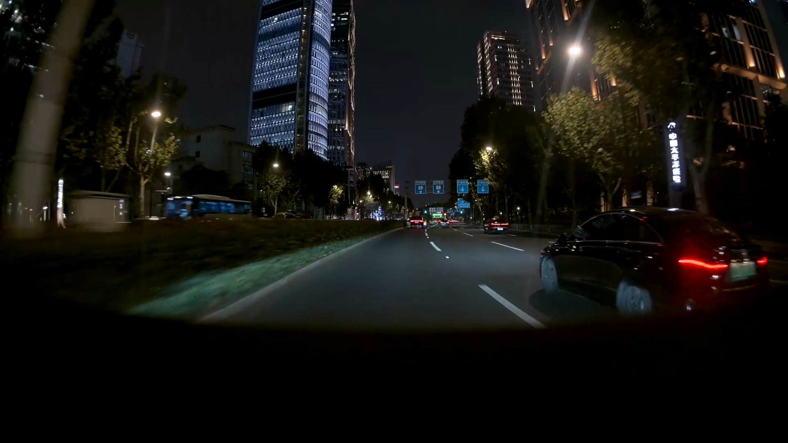

*图 1-0：第 1 题原始图像（行车记录仪夜间画面，1920×1080 PNG）*

画面是夜间路口，乍看完全正常。我先跑了 ELA，中间天空区有一块块异常均匀的色块——但那更像 PNG 转 JPEG 的量化残影，不敢直接当定罪证据用。

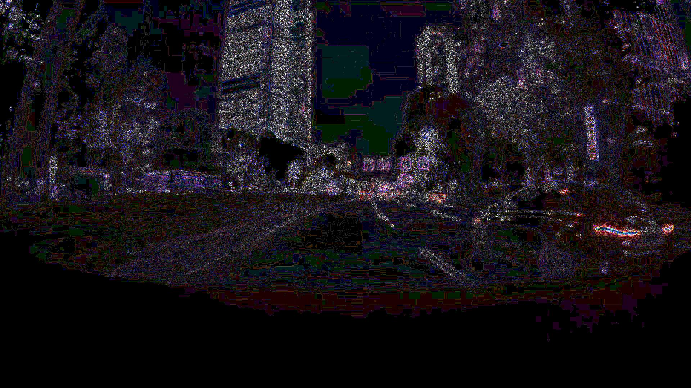

*图 1-1：行车记录仪画面 ELA（天空区色块后来确认是量化残影，不是定罪依据）*

真正卡住我的是坐标换算：我想放大看路牌细节，把查看器里缩略图坐标直接映射回原图坐标，连错了三四次，裁出来的全是对面楼的窗户。目测路线宣告失败后，放弃人眼，写了个脚本：先用 RGB 条件筛"路牌蓝"（B 通道高、B-R 大于 50、饱和度合适），再对命中像素做网格聚类，脚本直接给出路牌精确位置在 x≈1100、y≈440 附近。

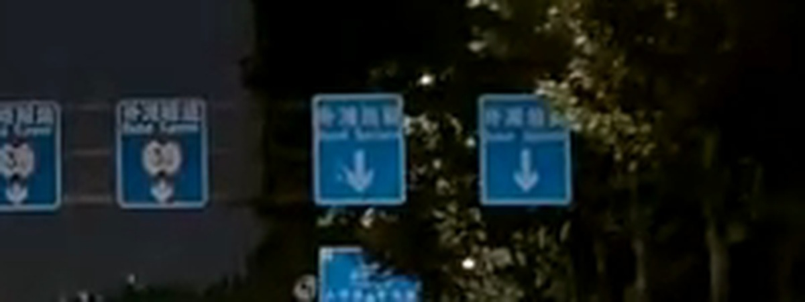

*图 1-2：脚本定位后的路牌区放大——龙门架上四块蓝色指路牌两两完全相同*

放大之后实锤了：龙门架上并排挂着四块蓝色指路牌，左边两块和右边两块**各自内部完全相同**。真实道路上同一龙门架的指路牌按车道分工，内容不可能两两一样——这是典型的复制粘贴重复，克隆块与周围天空的噪声纹理也不一致。文件本身是行车记录仪视频抽帧转存的 PNG，无原始设备元数据。答案选**对**。

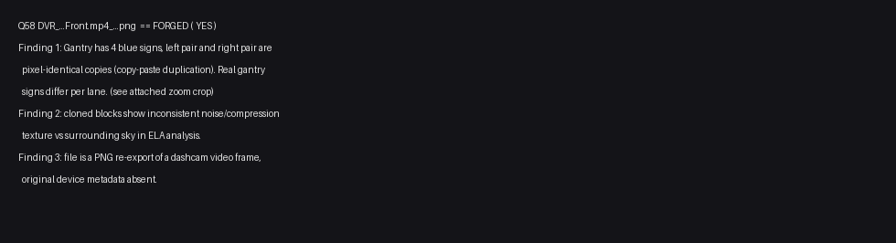

*图 1-3：考试系统提交的判断依据截图*

* * *

### 第 2 题

> **原题题干**：请观察并检验图像，请给出扩展名与实际格式不符的文件的文件名。（答案格式：文件名，如 abc.jpg）
>
> **检材文件**：`2.zip`（共 10 个文件）
>
> **答案**：`IMG_2159.png`

这题考的是文件头魔数排查，30 秒拿分的题型。解压后逐个读文件头 8 个字节：九个文件扩展名与魔数全部对得上，只有 `IMG_2159.png` 的头是 `FF D8 FF E1`——标准的 JPEG（SOI + APP1/EXIF），而 PNG 的标准头应该是 `89 50 4E 47 0D 0A 1A 0A`。

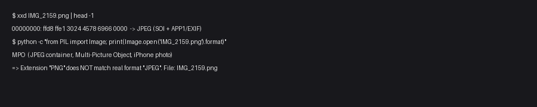

*图 2-1：IMG_2159.png 文件头魔数与实际格式核验*

用 PIL 打开它报的 format 是 MPO（iPhone 的多图对象格式，本质是 JPEG 容器），EXIF 里还带着 Apple iPhone 17 的完整拍摄信息——一个"扫描导出的 PNG"按理不该有手机拍摄链，进一步坐实了改扩展名的事实。答案 `IMG_2159.png`。

* * *

### 第 3 题

> **原题题干**：请观察并检验图像，判断图片是否为伪造图片？（是伪造请选择对，非伪造请选择错）
>
> **检材文件**：`MVIMG_20260811_184823.jpg`
>
> **答案**：**错**（原始真实图像，非伪造）

这张 9MB 的 3072x4096 图文件名叫 MVIMG_（Pixel 动态照片前缀），第一眼觉得"小米手机配 Pixel 命名"有点怪。但翻文件结构发现它保留了完整的小米拍摄链路：APP1 段里有 XIAOMI_CUSTOMIZE（MIX Flip 2、代号 Madrid）、ALGO_COMMON 加密块、AIScene/filterId 参数，中段还嵌着 HDR gain map 的 XMP（hdrgm 命名空间），文件尾 EOI 后还有 30KB 动态照片附加视频段。元数据链路自洽到这个程度，伪造者要完整复刻整条厂商私有链的成本极高，基本不可能是假的。

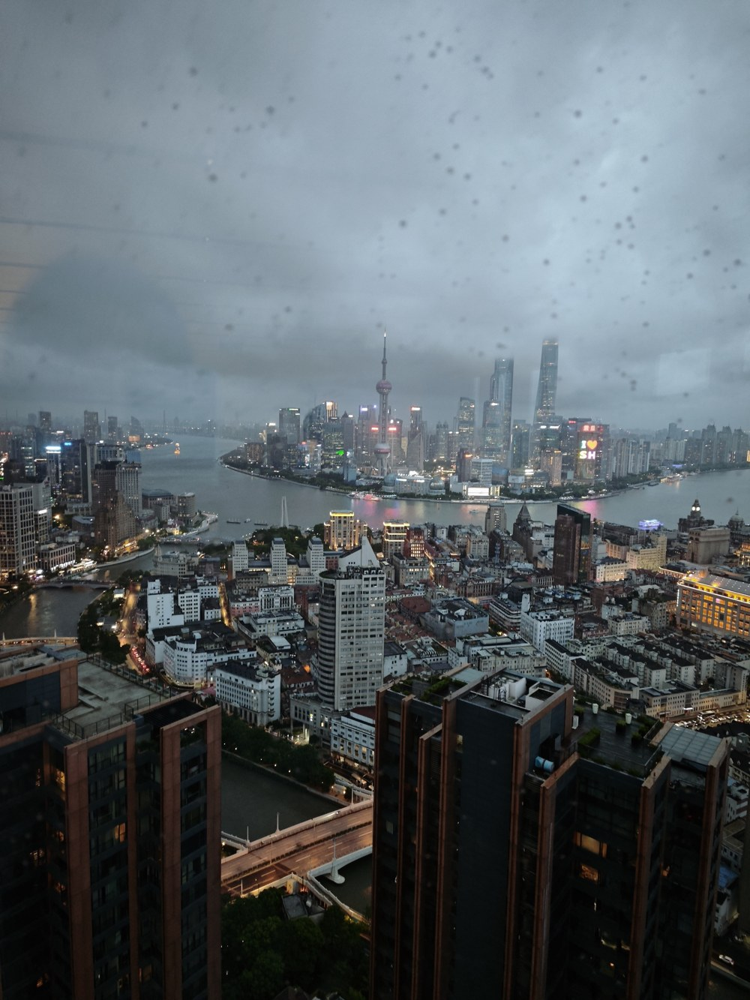

*图 3-1：第 3 题原始图像（夜间隔窗雨景）*

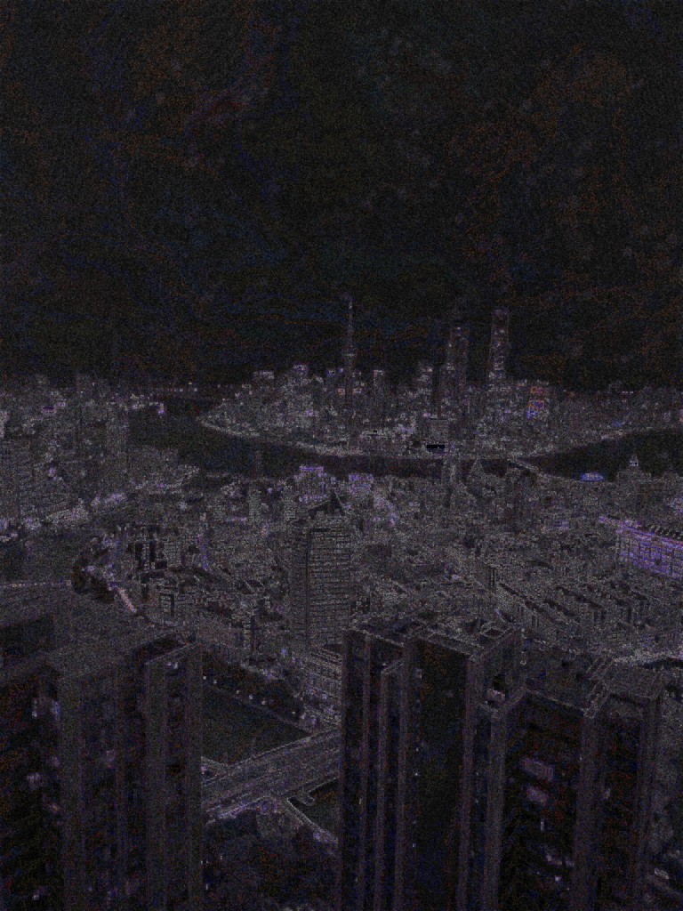

*图 3-2：ELA 未见局部异常块*

画面本身雨滴打在玻璃上、外滩夜景透视连贯，玻璃反光和雨滴散景自然，也没找到拼接痕迹。答案选**错**。这题的价值在于它是全卷"真图长什么样"的基准样本——完整自洽的厂商拍摄链 + 物理合理，后面所有判伪题都是拿它当对照组。

* * *

### 第 4 题

> **原题题干**：请观察并检验图像，判断图片是否为伪造图片？（是伪造请选择对，非伪造请选择错）
>
> **检材文件**：`IMG_20261117_0002.jpg`
>
> **答案**：**对**（伪造，元数据后期注入）

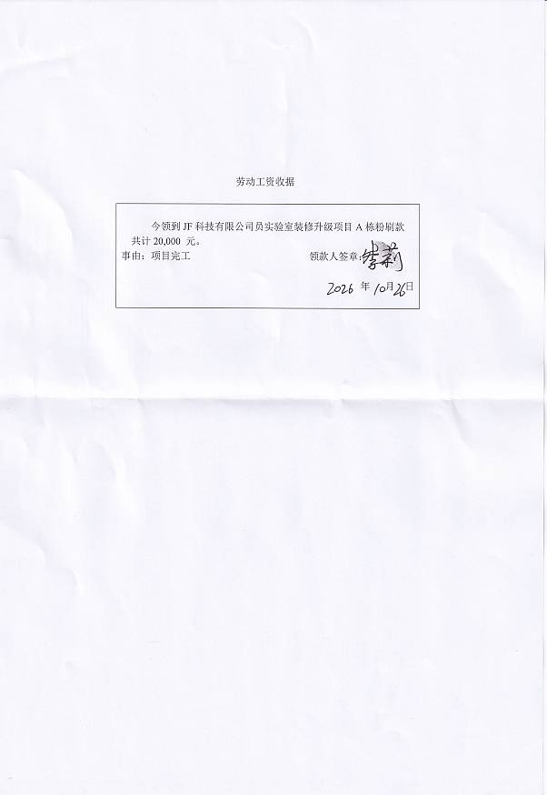

*图 4-0：第 4 题原始检材（劳动工资收据，602×874）*

一张"劳动工资收据"，20,000 元粉刷款，EXIF 写着 Canon CanoScan LiDE 400 + IJ Scan Utility。字迹、盖章放大看都挺自然，单看内容差点放过去。

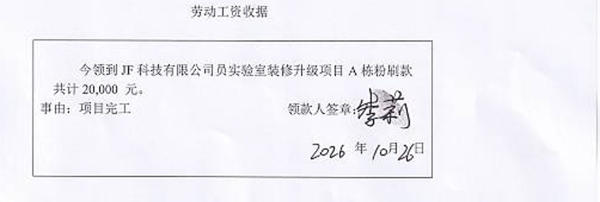

*图 4-1：收据关键区域放大——字迹、金额、签章肉眼均无异常*

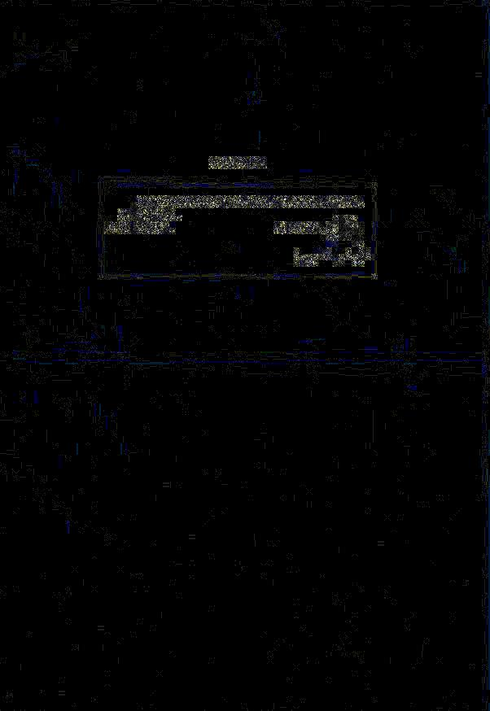

*图 4-2：全页 ELA——无明显局部异常（视觉路线在此题失效）*

转折在 EXIF 细节：DateTime 字段是 `2026/11/17 09:46:43`——**用斜杠分隔**。EXIF 标准规定日期格式必须是冒号分隔的 `yyyy:MM:dd HH:MM:SS`，扫描仪固件不会写错这种格式，这是 exiftool 之类的工具后期注入元数据的典型痕迹。再补两条佐证：EXIF 里没有真实扫描应有的 DateTimeOriginal 等字段，而且 75dpi 分辨率完全不符合 LiDE 400 的常规扫描设置。答案选**对**。

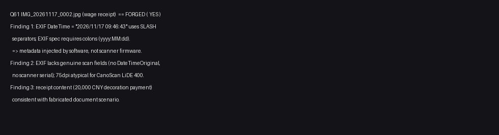

*图 4-3：考试系统提交的判断依据截图*

* * *

### 第 5 题

> **原题题干**：请给出存在 ContentProducer 标识的图像（），按照顺序填写对应的选项，如 ABCD（A 1.mp4 B 2.jpg C 3.mp4 D 4.mp4 E 5.jpg F 6.mp4 G 7.webp H 8.png I 9.png J 10.mp4）
>
> **检材文件**：`5.zip`（共 10 个文件）
>
> **答案**：`ACDFH`

ContentProducer 是内容溯源元数据标识（国内 AIGC 合规要求那类，类似 C2PA）。要点是对**原始字节**做检索，不是用图片查看器打开——标识藏在容器结构的私有字段里，查看器不显示。逐个文件搜 `ContentProducer` 字符串：

- 命中：1.mp4、3.mp4、4.mp4、6.mp4、8.png
- 未命中：2.jpg、5.jpg、7.webp、9.png、10.mp4

对应选项 **ACDFH**。

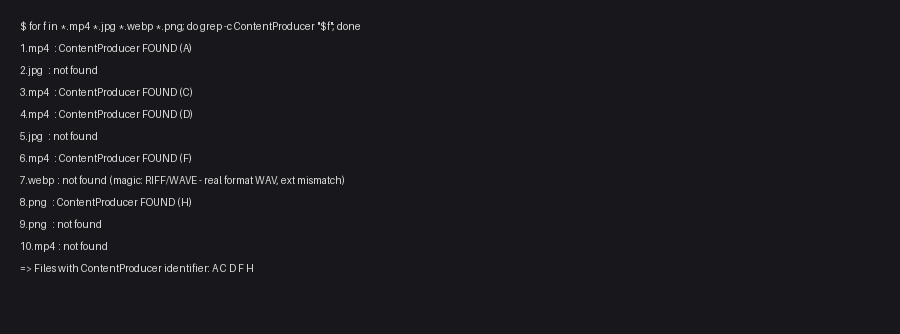

*图 5-1：10 个文件的 ContentProducer 逐字节检索结果*

顺手还发现一个彩蛋：7.webp 的魔数是 RIFF/WAVE，实际是个 WAV 音频改的扩展名混进来的。这提醒了一个原则：文件里没有隐式标识不等于它一定是实拍原图（可能被清洗过），但这题只问存在标识的选项，按序填 `ACDFH` 即可。

* * *

### 第 6 题

> **原题题干**：请观察并检验图像，判断图片是否为伪造图片？（是伪造请选择对，非伪造请选择错）
>
> **检材文件**：`Camera_XHS_...uhdr_...[1].jpg`
>
> **答案**：**错**（原始真实拍摄图像，非伪造）

小红书保存的桌面照片，1440x1080。单独看这张图：各物体（西数硬盘、键盘、显示器、桌面 U 盘）阴影透视一致，边缘自然无抠图痕迹。它的真正价值要到第 10 题才兑现——两张同场景图放在同一套卷子里，这张是保留完整场景的**原图**。

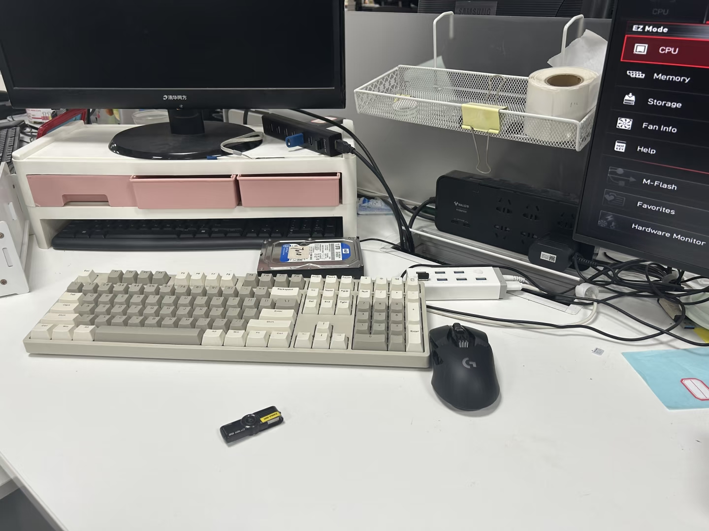

*图 6-1：第 6 题原始图像（桌面全景，U 盘完整保留）*

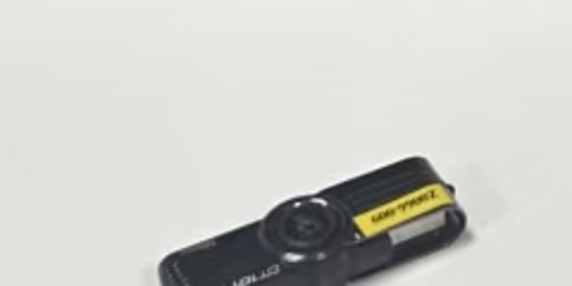

*图 6-2：前景 SanDisk U 盘放大——阴影方向与场景一致，无编辑痕迹*

小红书转码清掉了相机 EXIF，画面无 AI 特征、结构连贯。答案选**错**。

* * *

### 第 7 题

> **原题题干**：请观察并检验图像，判断图片是否为伪造图片？（是伪造请选择对，非伪造请选择错）
>
> **检材文件**：`007.jpg`
>
> **答案**：**对**（伪造，AI 生成）

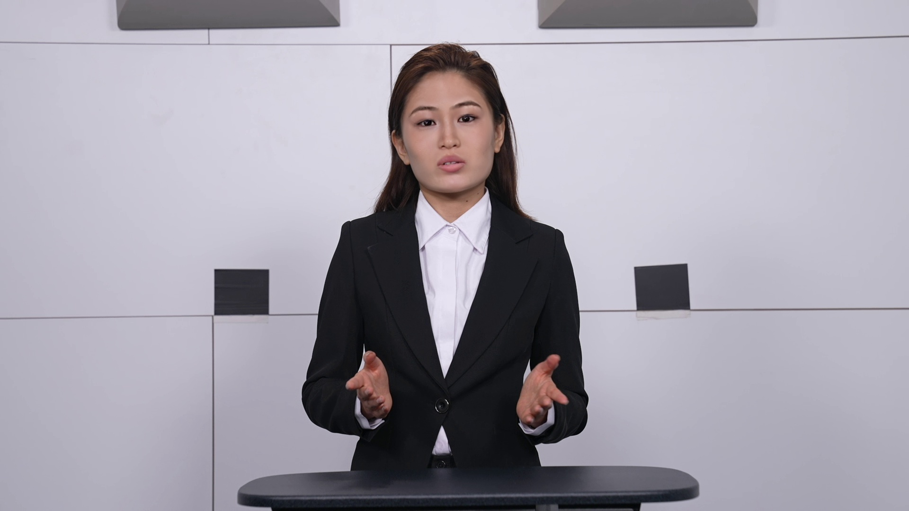

*图 7-0：第 7 题原始图像（新闻演播室风格，1920×1080）*

1920x1080、零元数据、标准量化表，这组特征已经有点可疑了。看脸：皮肤过分光滑，毛孔和发丝细节全无，蜡像感很强。

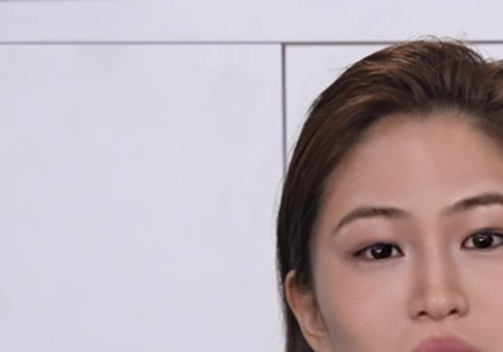

*图 7-1：面部放大——皮肤蜡像感、细节缺失*

真正一锤定音的是手——这是生成模型至今没修干净的部位：

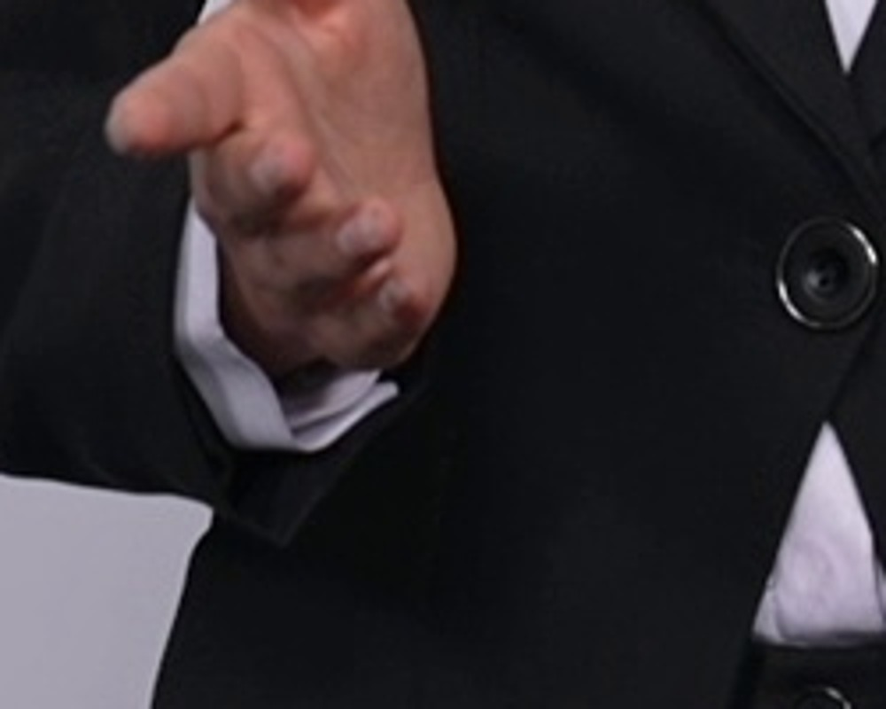

*图 7-2：左手放大——手指畸形融合、指节数量异常*

*图 7-3：右手放大——同样的融合伪影*

双手手指畸形融合加皮肤蜡像感，再加零元数据和 1920x1080 这个 AI 生成图常见输出分辨率，多重印证。答案选**对**。方法论上值得强调的是：蜡像感是软证据（美颜滤镜也能造成），手指畸形是硬证据（没有合理替代解释）——这道题的定罪权重全在手上。

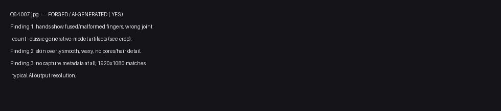

*图 7-4：考试系统提交的判断依据截图*

* * *

### 第 8 题

> **原题题干**：请给出文件 gen_012.png 的 seed 值（答案格式：阿拉伯数字，如 123）
>
> **检材文件**：`gen_012.png`
>
> **答案**：`873421`

解析 PNG chunk 结构，tEXt 块里躺着 ComfyUI 的完整 workflow JSON，KSampler 节点写得明明白白：`seed: 873421, steps: 25, cfg: 7.0, sampler euler, denoise 1.0`，Software 字段就是 ComfyUI。

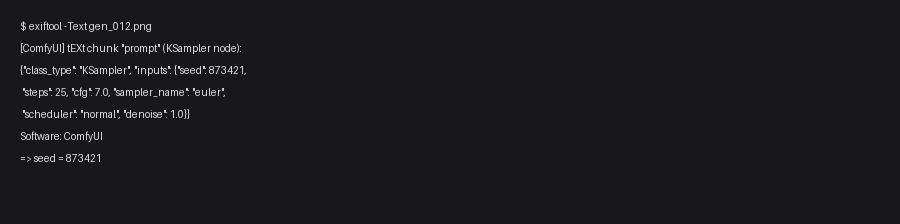

*图 8-1：tEXt 块中 ComfyUI workflow 与 KSampler seed 提取*

答案是 **873421**。这里有个生成图的悖论：使用者为了复现而保留的参数，恰恰成了取证者手里的铁证。

* * *

### 第 9 题

> **原题题干**：请观察并检验图像，判断图片是否为伪造图片？（是伪造请选择对，非伪造请选择错）
>
> **检材文件**：`res17.png`
>
> **答案**：**对**（伪造，Stable Diffusion 局部重绘）

其实不用看图。PNG 的 tEXt 块里直接躺着 Stable Diffusion WebUI 的 parameters：Steps 40、DPM++ 2M Karras、Seed 2585072283、Model 512-base-ema、Denoising strength 0.2，而且带 Mask 字段——说明做过局部重绘（inpaint）。元数据自己就交代了。

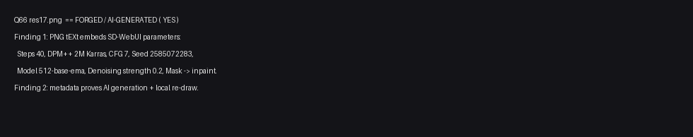

*图 9-1：tEXt(parameters) 中的 SD WebUI 局部重绘参数*

答案选**对**。这题和第 8 题是同一类考法：生成工具的参数残留是最便宜的硬证据。

* * *

### 第 10 题

> **原题题干**：请观察并检验图像，判断图片是否为伪造图片？（是伪造请选择对，非伪造请选择错）
>
> **检材文件**：`Camera_XHS_...notes_...[1].jpg`
>
> **答案**：**对**（伪造，AI 物体消除）

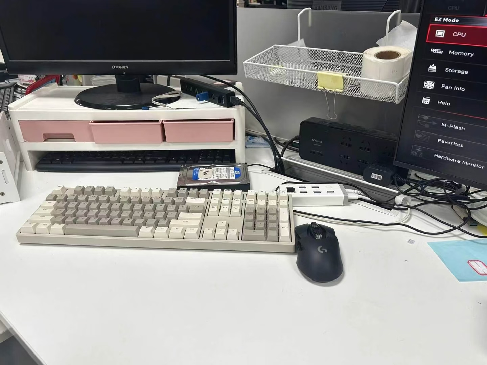

*图 10-0：第 10 题原始图像（同一桌面场景，U 盘已被抹除）*

两张小红书图（第 6 题和本题）都来自小红书，1440x1080，内容一模一样的桌面场景。两张同场景图放在同一套卷子里，基本就是在考"找不同"。我把两张图对齐（最佳偏移恰好是 0,0）后做像素级 diff，高差异块集中在两处。逐块裁出来对比确认：**第 6 题桌面上有 SanDisk U 盘，本题里 U 盘没了，原来的位置留着一块内容感知填充的模糊残影**——本题是把第 6 题里的 U 盘抹掉后的产物。

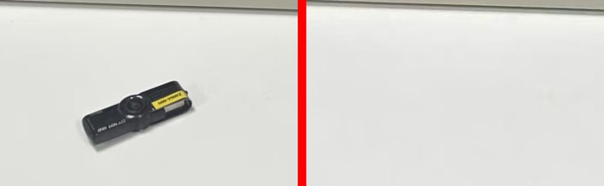

*图 10-1：左右对比——左（第 6 题）桌面有 U 盘，右（本题）同一位置只剩涂抹残影*

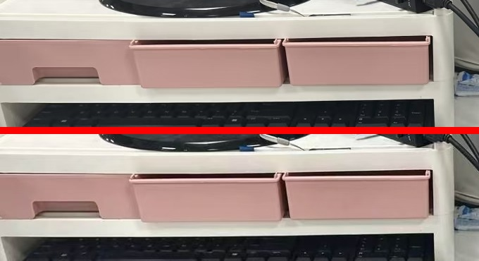

*图 10-2：抽屉区上下对照——其余区域完全一致，篡改仅发生在 U 盘位置*

抹除区域与周边桌面噪声纹理不一致，差异图里还能看到 U 盘轮廓残迹。答案选**对**。

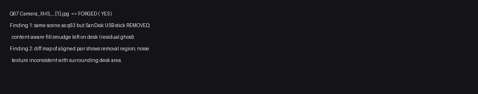

*图 10-3：考试系统提交的判断依据截图*

这题是全卷方法论含金量最高的一道：单独看任何一张图都看不出问题，"抹除物体"这种高级篡改视觉检查很难发现，但在同源图对齐 diff 面前无所遁形。

* * *

## 小结

如果把这 10 题的方法浓缩成一段可以讲给别人的话，我会先放出这张流程图，然后沿着图从上往下讲。

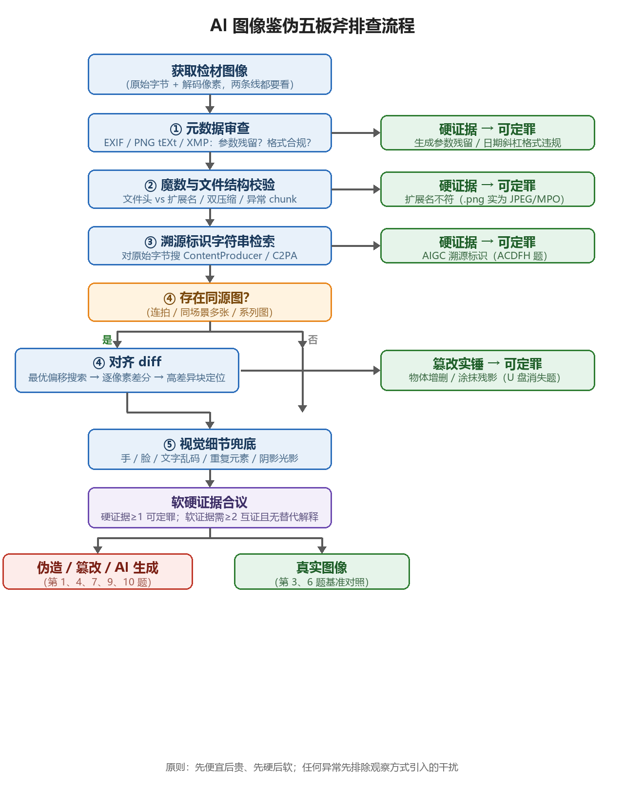

*图 S-1：五板斧排查流程——主流程自上而下，右侧绿色框是各步命中后的定罪出口*

**先说图的读法。** 中间蓝色竖列是排查主流程，按"先便宜后贵、先硬后软"的顺序排；每个步骤右侧引出一条绿色分支，代表这一步命中硬证据后的"提前定罪出口"——意思是流程不用走完，任何一步拿到硬证据就可以直接下结论。最后经过紫色合议框，分出红色（伪造）和绿色（真实）两个出口。

**然后沿着主流程一步步讲。**

第一步元数据审查，是整条流水线里性价比最高的动作。它有三种打开方式：正向用，是找生成工具留下的参数残留——第 8 题 ComfyUI 的 seed 873421、第 9 题 SD WebUI 的 inpaint 参数，都是打开 tEXt 块直接读答案；反向用，是查元数据本身合不合规——第 4 题收据的斜杠日期，扫描仪固件写不出这种格式，元数据伪造本身就构成定罪；还有第三种用法容易被忽略：第 3 题那张小米夜景，完整自洽的厂商私有链（XIAOMI_CUSTOMIZE、HDR gain map、动态视频段）反过来证明了"这是真的"。同一个动作，三个方向。

第二步魔数校验，一句话就能讲完：扩展名是给人看的，文件头是给真相的。第 2 题的 IMG_2159.png，头字节 `FF D8 FF E1` 出卖了一切。这一步成本几乎为零，属于"不做白不做、做了必拿分"。

第三步字符串检索，关键在"对原始字节搜"。第 5 题的 ContentProducer 标识藏在 MP4 容器的私有字段里，用图片查看器打开永远看不到，必须直接对字节做检索——这是"ACDFH"四个字母的来源。顺手还捞到 7.webp 实为 WAV 音频的彩蛋。

第四步是流程里唯一的分支：存不存在同源图？第 6 题和第 10 题就是为这个分支设计的——两张同场景图对齐后逐像素差分，第 10 题被抹掉的 U 盘和残留的涂抹痕迹直接从差异图里跳出来。这一步是抓"局部篡改"的杀手锏，因为内容感知填充能骗过人眼，骗不过差分。没有同源图就走"否"的支路，靠双压缩检测、噪声一致性这些图内统计特征替代。

第五步视觉兜底排在最后，不是因为它不重要，而是因为它最贵也最主观。第 7 题的定罪证据是畸形融合的手指——这是硬证据；但同一张图里的"皮肤蜡像感"只是软证据，美颜滤镜也能造成。视觉检查的黄金法则：手、脸、文字、重复元素四个部位优先，其中只有能找到"无合理替代解释"的异常才算数。

**讲完流程，最后落在紫色合议框上，这是整套方法的核心纪律：软硬证据分家。**

硬证据是"没有合理替代解释"的异常——生成参数残留、溯源标识命中、魔数不符、EXIF 格式违规、畸形手指、同源 diff 出的物体消失，任意一条都可以单独定罪。软证据是"有多种可能成因"的异常——ELA 色块、蜡像皮肤、噪点不均，必须两条以上相互印证才能参与裁决。我自己踩过的坑就是第 1 题：ELA 的天空色块差点把我带偏，最后定罪靠的是"四块路牌两两相同"这个内容级硬证据，ELA 只配当旁证。

图底部那行原则也值得展开一句：**任何异常，先排除观察方式引入的干扰。** 照片会被倒置（oppo 倒过来读成 oddo 的教训）、镜像、缩放、转码，每一步采集环节都可能制造假线索——先怀疑自己看的方式，再怀疑检材。

说到底，这套五板斧的本质只有一句话：**真图是"设备 + 光学 + 编码"三条链共同作用的产物，鉴伪就是在找链条上"不该存在的差异"。** 每一步工具，都只是在某一条链上放大镜而已。

